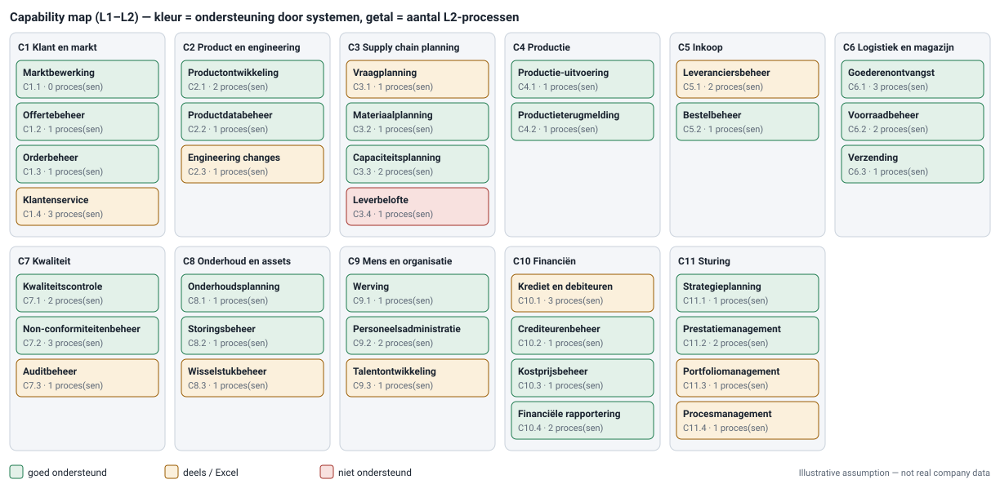

# Capability map

> **Wat:** wat Corvent moet *kunnen*, los van wie het doet of hoe; de stabiele laag waar processen, applicaties en investeringen aan hangen.
> **Voor wie:** enterprise architectuur, management, de process architect.
> *Illustrative assumption — not real company data.*

← [Maturiteitsscan](../01-frame/maturiteitsscan.md) · Volgende: [Procesboom](procesboom.md) →

*Gegenereerd uit [`catalog/catalog.json`](../../catalog/catalog.json). Kleur = hoe goed systemen de capability ondersteunen; getal = aantal L2-processen dat de capability uitvoert.*

## Regels die ik hanteer

| Regel | Waarom | Voorbeeld |
|---|---|---|
| Capabilities zijn **zelfstandige naamwoorden**, processen **object + werkwoord** | anders wordt de capability map een tweede procesboom | capability *Leverbelofte* ↔ proces *Leverdatum bevestigen* |
| Geen afdelingsnamen | een reorganisatie mag de map niet breken | *Kwaliteitscontrole*, niet *Afdeling QA* |
| Twee niveaus, maximaal drie | management leest het op één pagina | 11 × L1, 35 × L2 |
| Elk L2-proces wijst naar minstens één capability | zo zie je welke capability door geen enkel proces wordt uitgevoerd | C1.1 *Marktbewerking*: 0 processen → gat in de catalogus, niet in de map |
| De heatmap gaat over ondersteuning, niet over prestaties | dat is de vraag die EA en het ERP-project stellen | C3.4 *Leverbelofte*: rood, het ERP heeft geen capaciteitscheck (ATP/CTP) |

## Wat de map nu al vertelt

1. **C3.4 Leverbelofte is niet ondersteund.** Precies daar zit het eigenaarsconflict sales ↔ planning. Het [referentiemodel](../04-reference-model/order-to-cash.md) en [OTC-03](../05-review/review-otc-03.md) gaan daarover. Het ERP-project moet de capaciteitscheck meenemen in fit-to-standard.
2. **C10.1 Krediet en debiteuren staat op oranje.** De kredietcheck gaat per mail, en dat is pijnpunt P2 in de as-is van OTC-02.
3. **C1.4 Klantenservice staat op oranje en wordt door 3 processen uitgevoerd**, terwijl L1 issue-to-resolution geen eigenaar heeft. De capability is bekend, de verantwoordelijkheid niet.
4. **C1.1 Marktbewerking heeft geen proces.** Ofwel ontbreekt er een L2 (bijvoorbeeld *Campagne opzetten*), ofwel valt het buiten het proceshuis. Dat beslist de procesraad, niet de architect.

## Hoe de map gebruikt wordt

- **Enterprise architectuur:** applicaties worden op capabilities gemapt (zie [proces ↔ applicatie](proces-applicatie.md)). Zo landt een vraag als "wat raakt de ERP-upgrade?" via de capability bij de processen en hun eigenaars.
- **Investeringen:** een rode of oranje capability met veel processen is een kandidaat voor de roadmap.
- **Projecten:** elk project noemt bij de start de capabilities die het raakt. De catalogus geeft dan meteen de processen en eigenaars.

Bronnen voor de aanpak: TOGAF Business Architecture ([The Open Group](https://www.opengroup.org/togaf)) en de BIZBOK-principes van de Business Architecture Guild.
