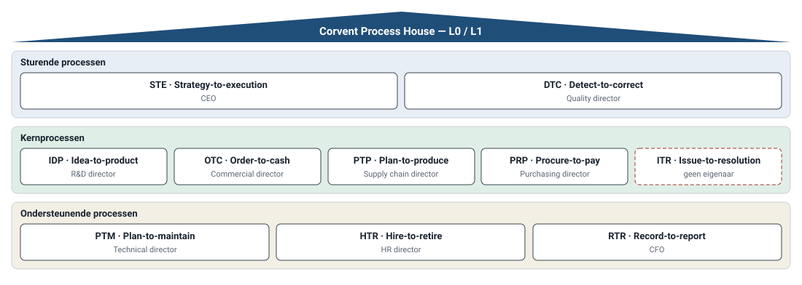

# Procesboom en procesniveaus

> **Wat:** de structuur van het proceshuis (L0–L4), welke notatie per niveau en voor welke lezer, en de tien end-to-end processen.
> **Voor wie:** analisten, management, EA, projecten.
> *Illustrative assumption — not real company data.*

← [Capability map](capability-map.md) · Volgende: [Proces ↔ applicatie](proces-applicatie.md) →

*Gegenereerd uit de catalogus. Rode stippellijn = L1 zonder eigenaar.*

## Niveaus

| Niveau | Wat | Voorbeeld | Notatie | Lezer | Eigenaar |
|---|---|---|---|---|---|
| **L0** | procesgroep | Kernprocessen | proceshuis | directie | — |
| **L1** | end-to-end proces, van klantvraag tot resultaat | OTC Order-to-cash | waardeketen (chevrons) | directie, procesraad | L1-eigenaar (directeur) |
| **L2** | proces met één duidelijk resultaat | OTC-03 Leverdatum bevestigen | catalogusregel + eventueel SIPOC | management, projecten | L2-eigenaar (manager) |
| **L3** | verloop van een L2-proces: rollen, beslissingen, uitzonderingen | BPMN-model OTC-03 | BPMN 2.0 volgens de [conventie](../03-standards/modelleerconventie.md) | analisten, key users, IT | L2-eigenaar; analist houdt bij |
| **L4** | werkinstructie of systeemstap | "Leverdatum vastleggen in ERP-scherm X" | instructie, schermafdruk | uitvoerders | process steward |

L4 hoort niet in de catalogus. Een L3-model verwijst ernaar, en de procesraad beslist niet over werkinstructies.

## De tien end-to-end processen (L1)

| L0 | ID | E2E-proces | Van … tot … | L1-eigenaar |
|---|---|---|---|---|
| Sturend | STE | Strategy-to-execution | strategie → uitgevoerd jaarplan | CEO |
| Sturend | DTC | Detect-to-correct | afwijking → corrigerende maatregel | Quality director |
| Kern | IDP | Idea-to-product | idee → vrijgegeven product | R&D director |
| Kern | OTC | Order-to-cash | klantorder → ontvangen betaling | Commercial director |
| Kern | PTP | Plan-to-produce | vraagplan → geproduceerd eindproduct | Supply chain director |
| Kern | PRP | Procure-to-pay | behoefte → betaalde leverancier | Purchasing director |
| Kern | ITR | Issue-to-resolution | klacht of servicevraag → oplossing | **geen** (governance-gat) |
| Ondersteunend | PTM | Plan-to-maintain | onderhoudsbehoefte → beschikbare installatie | Technical director |
| Ondersteunend | HTR | Hire-to-retire | vacature → vertrek | HR director |
| Ondersteunend | RTR | Record-to-report | boeking → rapport | CFO |

De volledige lijst met 41 actieve L2-processen staat in de [procescatalogus](procescatalogus.md).

## Order-to-cash als waardeketen (L1 → L2)

## Overdrachten tussen E2E-processen

Een E2E-proces stopt niet aan een afdelingsgrens, maar het raakt wel andere E2E-processen. Die overdrachten leg ik expliciet vast, want daar ontstaan de meeste fouten en wachttijden.

| Van | Naar | Wat gaat over | Eigenaar van de overdracht |
|---|---|---|---|
| OTC-02 Order aanvaarden | OTC-03 Leverdatum bevestigen | aanvaarde order met gevraagde datum | Customer service manager |
| OTC-03 Leverdatum bevestigen | PTP-03 Productieorder plannen en vrijgeven | bevestigde datum = harde planningsvraag | **open — D-03** |
| PTP-05 Eindproduct keuren en stockeren | OTC-04 Order uitleveren | vrijgegeven goederen in WMS | Logistics manager |
| OTC-04 Order uitleveren | OTC-05 Klant factureren | leverbon = factuurtrigger | Finance manager |
| ITR-01 Klachten behandelen | DTC-02 Non-conformiteit behandelen | klacht met productoorzaak | Quality manager |

## Waarom deze opbouw

- **Breed en ondiep eerst:** alle L1- en L2-processen staan erin met hun beheergegevens, maar L3 werk ik alleen uit waar het ERP-project of een pijnpunt het vraagt ([ADR-003](../adr/003-breed-ondiep-eerst.md)).
- **Bekende E2E-namen** (order-to-cash, procure-to-pay, …) maken vergelijken met referentiekaders zoals APQC PCF eenvoudig. De Nederlandse omschrijving staat erbij voor de werkvloer.
- **De consultant-boom blijft de basis.** Ik heb één overlap opgelost (klachten, D-02) en niets hertekend.
