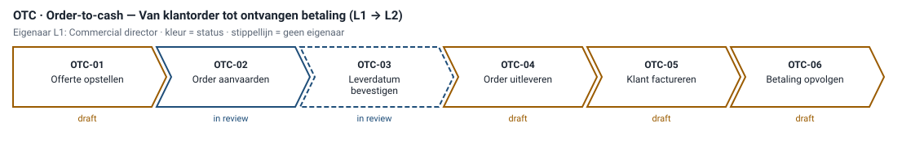
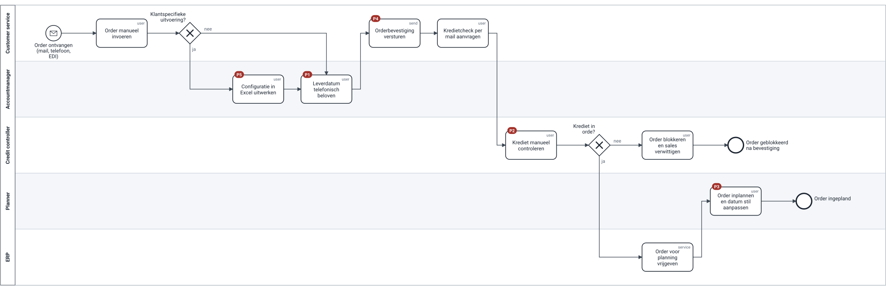
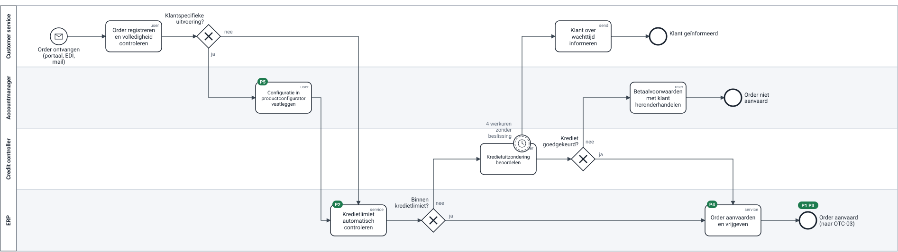

# Referentiemodel order-to-cash — OTC-02 Order aanvaarden

> **Wat:** het eerste model dat volledig volgens de nieuwe standaard is uitgewerkt, van L1 tot L3, as-is en to-be. Het dient als voorbeeld voor de analisten en als input voor de fit-to-standard-workshop van het ERP-project.
> **Voor wie:** analisten, customer service, sales, finance, ERP-projectteam.
> Eigenaar: Customer service manager · Status to-be: in review · Capability: C1.3 Orderbeheer, C10.1 Krediet en debiteuren · Systemen: ERP, CRM, EDI
> Volgt: [OTC-03 Leverdatum bevestigen](../05-review/review-otc-03.md)
> *Illustrative assumption — not real company data.*

← [Documentatiesjabloon](../03-standards/documentatiesjabloon.md) · Volgende: [Review OTC-03](../05-review/review-otc-03.md) →

## Waarom OTC eerst

Het ERP-project begint zijn fit-to-standard-workshops bij order-to-cash. Daarnaast zitten twee van de drie grootste klachten uit de one-pager (late leveringen, trage bevestiging) in deze keten ([ADR-003](../adr/003-breed-ondiep-eerst.md)).

## L1 → L2

OTC-07 *Klachten behandelen* staat niet meer in de keten: de procesraad besliste dat klachten onder ITR-01 vallen (D-02).

## Doel en resultaat

Een binnenkomende order wordt volledig, met de juiste configuratie en binnen het kredietkader **aanvaard** of gemotiveerd **niet aanvaard**. De leverdatum wordt in OTC-03 bevestigd, niet hier.

## Afbakening (SIPOC)

| Suppliers | Inputs | Process | Outputs | Customers |
|---|---|---|---|---|
| klant, accountmanager, credit controller | order (portaal, EDI, mail), klantdata, kredietlimiet, productconfiguratie | 1. order registreren · 2. configuratie vastleggen · 3. krediet controleren · 4. uitzondering beoordelen · 5. order aanvaarden | aanvaarde order (naar OTC-03) of gemotiveerde weigering | OTC-03 (planning), klant, finance |

## As-is (vandaag)

BPMN-bestand: [`bpmn/otc-02-as-is.bpmn`](bpmn/otc-02-as-is.bpmn) · gevalideerd op 2026-09-24 in een workshop met customer service en planning.

| ID | Pijnpunt | Gevolg (illustratief) |
|---|---|---|
| P1 | De accountmanager belooft een leverdatum aan de telefoon, zonder capaciteitscheck | OTIF 78% |
| P2 | De kredietcheck gaat per mail en wordt manueel gedaan | 31% van de orders wacht gemiddeld 6 werkuren |
| P3 | De planner past de datum stil aan; niemand verwittigt de klant | klachten bij customer service |
| P4 | De orderbevestiging vertrekt vóór het kredietakkoord | geblokkeerde orders na bevestiging (±2 per week) |
| P5 | Een configuratie op maat wordt in Excel uitgewerkt | overtypfouten, geen historiek |

## To-be v1.0

BPMN-bestand: [`bpmn/otc-02-to-be.bpmn`](bpmn/otc-02-to-be.bpmn) · haalt alle automatische checks ([rapport](https://phlppgdfry.github.io/manufacturing-process-architecture-case/demo/#review)).

| Wat verandert | Lost op | Waarom zo |
|---|---|---|
| Configuratie op maat in de productconfigurator (CRM) in plaats van Excel | P5 | de capability bestaat al in het CRM, maar wordt niet gebruikt |
| Kredietlimiet automatisch gecontroleerd; alleen uitzonderingen naar de credit controller | P2 | 69% van de orders zit ruim binnen de limiet (illustratief); manueel werk alleen waar oordeel nodig is |
| Order pas aanvaard na kredietakkoord; de bevestiging vertrekt in OTC-03 | P4 | de volgorde ligt nu vast in het model |
| De leverdatum wordt niet meer hier beloofd, maar in OTC-03 voorgesteld en bevestigd | P1, P3 | belofte en capaciteit komen samen in één proces met één eigenaar (D-03) |
| Non-interrupting timer: na 4 werkuren zonder kredietbeslissing wordt de klant geïnformeerd | — | de klant wacht niet in het ongewisse; de beslissing zelf loopt door |

## Rollen

| Rol (lane) | Doet | Beslist |
|---|---|---|
| Customer service | registreert, controleert volledigheid, informeert de klant | of de order volledig is |
| Accountmanager | legt configuratie vast, heronderhandelt voorwaarden | — (stelt voor aan de klant) |
| Credit controller | beoordeelt kredietuitzonderingen | krediet akkoord of niet |
| ERP | controleert limiet, aanvaardt en geeft vrij | — (regel) |

## Uitzonderingen

| Uitzondering | Waar | Afhandeling |
|---|---|---|
| Order buiten kredietlimiet | gateway *Binnen kredietlimiet?* → nee | credit controller beoordeelt |
| Geen kredietbeslissing binnen 4 werkuren | boundary timer op *Kredietuitzondering beoordelen* | klant geïnformeerd; beslissing loopt door |
| Krediet geweigerd | gateway *Krediet goedgekeurd?* → nee | accountmanager heronderhandelt; order niet aanvaard |

## Regels en drempels

| Regel | Waarde (illustratief) | Eigenaar van de regel |
|---|---|---|
| Automatische kredietgoedkeuring | openstaand saldo + order ≤ kredietlimiet én geen vervallen facturen > 30 dagen | Credit manager |
| Wachttijd vóór klantinformatie | 4 werkuren | Customer service manager |
| Order is volledig | klant, artikel/configuratie, hoeveelheid, gevraagde datum, leveradres | Customer service manager |

## KPI's

| KPI | Definitie | Nulmeting | Doel | Bron |
|---|---|---:|---:|---|
| Doorlooptijd order → aanvaard | werkuren tussen ontvangst en aanvaarding | 9,5 u | 2 u | ERP-tijdstempels |
| % orders met manuele kredietcheck | uitzonderingen / alle orders | 31% | ≤ 10% | ERP |
| Geblokkeerd na bevestiging | aantal per maand | 8 | 0 | ERP |

## Open punten

| ID | Vraag | Wie beslist | Status |
|---|---|---|---|
| D-03 | Wie is eigenaar van de bevestigde leverdatum (OTC-03)? | procesraad | voorstel klaar, zie [procesraad](../06-governance/procesraad.md) |
| D-04 | Release van deze to-be vóór de fit-to-standard-workshop | L2-eigenaar | na D-03 |
| — | Kan de productconfigurator alle varianten aan, of blijft een rest in Excel? | ERP-project + accountmanagers | open; meegenomen in fit-to-standard |

## Wijzigingshistoriek

| Versie | Datum | Wijziging | Goedgekeurd door |
|---|---|---|---|
| 0.9 (as-is) | 2026-09-24 | as-is gevalideerd in workshop | — |
| 1.0 (to-be) | 2026-10-08 | eerste to-be volgens conventie v1.0 | in review |
