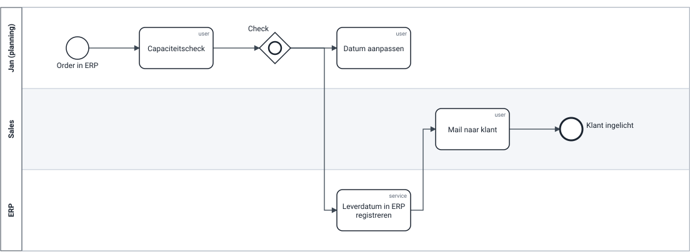
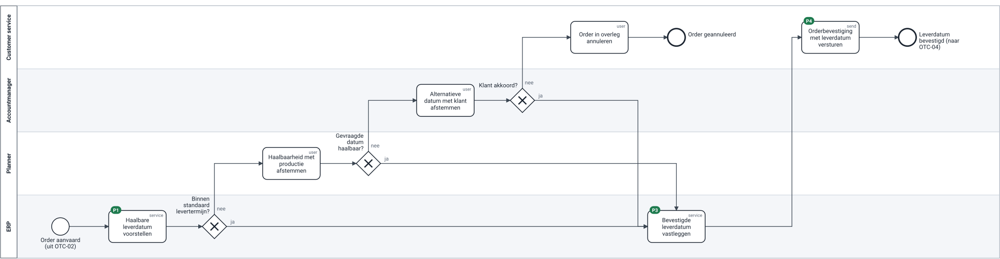

# Review van een analistenmodel — OTC-03 Leverdatum bevestigen

> **Wat:** hoe een review volgens de nieuwe standaard verloopt: het draft-model van een analist, het automatische rapport, mijn feedback (maximaal 5 punten) en de herwerkte versie.
> **Voor wie:** analisten (zo ziet een review eruit), hiring managers (zo coach ik).
> *Fictieve situatie. De analist is een rol, geen persoon. Illustrative assumption — not real company data.*

← [Referentiemodel order-to-cash](../04-reference-model/order-to-cash.md) · Volgende: [Onboarding-kit analist](onboarding-analist.md) →

## Context

Een analist in het supply-chain-domein, met jaren ervaring in planning, levert een eerste model voor *Leverdatum bevestigen* aan. Het is gemaakt vóór de conventie bestond en dient nu als testcase. De analist kent het proces beter dan ik. Mijn rol is het model leesbaar, vergelijkbaar en beslisbaar maken, niet het proces opnieuw bedenken.

## 1. Het draft-model

Bestand: [`bpmn/otc-03.draft.bpmn`](bpmn/otc-03.draft.bpmn)

## 2. Het automatische rapport

`python3 scripts/check_models.py docs/05-review/bpmn/otc-03.draft.bpmn`

| Regel | Element | Bevinding |
|---|---|---|
| R02 | Datum aanpassen | pad eindigt niet in een eindevent (losse draad) |
| R03 | Capaciteitscheck | taaknaam is geen "object + werkwoord" |
| R03 | Mail naar klant | taaknaam is geen "object + werkwoord" |
| R04 | Check | splitsende gateway heeft geen vraag als naam |
| R05 | Check | 2 uitgaande flows zonder label |
| R06 | Check | element `inclusiveGateway` staat niet in het palet |
| R09 | — | verplichte attributen ontbreken (procesId, niveau, type, eigenaar, versie, status) |
| R11 | Jan (planning) | lane is geen rol of systeem |
| R11 | Sales | lane is geen rol of systeem |

**9 bevindingen op 7 regels.** De analist ziet dit rapport vóór mijn review. Naamgeving (R03), labels (R05) en attributen (R09) lost hij zelf op met de checklist; daar hoeft geen gesprek over te gaan.

## 3. Mijn feedback: 5 punten, gerangschikt op impact

Ik geef nooit meer dan vijf punten per ronde. Waarom deze vijf: ze gaan over **betekenis**, niet over vorm. Elk punt is een vraag, geen oplossing.

| # | Regel | Feedback (zoals ik het schrijf) | Waarom dit belangrijk is |
|---|---|---|---|
| 1 | R02 / M04 | "Na *Datum aanpassen* stopt het model. Wat gebeurt er als de gevraagde datum niet haalbaar is: wie belt de klant, en wat als de klant niet akkoord gaat?" | dit is precies het pad dat vandaag misloopt (P3: de datum wordt stil aangepast) |
| 2 | R06 / M04 | "De inclusieve gateway laat meerdere paden tegelijk toe. Bedoel je: als de datum haalbaar is, bevestigen, en anders aanpassen? Dan is het één vraag met twee antwoorden." | een inclusive gateway wordt door bijna iedereen anders gelezen; in het ERP-project wordt dat een discussie |
| 3 | R11 | "De lanes zijn *Jan (planning)* en *Sales*. Welke rol beslist over de datum: de planner, of de accountmanager na overleg met de klant?" | eigenaarschap hangt aan een rol; dit legt het conflict sales ↔ planning bloot |
| 4 | M02 | "Het model start bij *Order in ERP*. Volgens OTC-02 start dit proces pas na kredietakkoord. Klopt dat voor jou, en waar gaat het resultaat naartoe (OTC-04, PTP-03)?" | zonder overdracht is het geen deel van een E2E-proces |
| 5 | M01 | "Voor wie is dit model: de planner of de fit-to-standard-workshop? Voor de workshop mag het ERP-voorstel (capaciteitscheck) een eigen taak zijn." | het detailniveau bepaalt wat erin hoort |

**Wat ik bewust níet zeg:** "teken het zoals in het referentiemodel". De analist kiest de oplossing; de conventie bepaalt alleen de vorm.

## 4. Na het gesprek (30 minuten)

- De analist bevestigt het conflict: sales belooft, planning beslist, en niemand is eigenaar van de belofte. **Het model kan dat niet oplossen.** Het wordt een beslissing voor de procesraad: voorstel D-03.
- De analist stelt zelf een eerste ERP-voorstel van de datum voor (capaciteitscheck). Dat is beter dan wat ik had: het maakt de standaardgevallen automatisch.
- De analist wil pijnpunten blijven nummeren zoals hij altijd deed. Dat zit al in de conventie (regel 6), overgenomen uit zijn modellen.

## 5. De herwerkte versie (v1.0, in review)

Bestand: [`bpmn/otc-03-to-be.bpmn`](bpmn/otc-03-to-be.bpmn) — **0 bevindingen**.

| Wat veranderde | Feedbackpunt |
|---|---|
| Uitzonderingspad: niet haalbaar → accountmanager stemt alternatief af met de klant → akkoord of annuleren | 1 |
| Inclusive gateway vervangen door drie exclusieve vragen (standaard termijn? haalbaar? klant akkoord?) | 2 |
| Lanes = rollen: customer service, accountmanager, planner, ERP | 3 |
| Start *Order aanvaard (uit OTC-02)*, einde *Leverdatum bevestigd (naar OTC-04)* | 4 |
| ERP stelt een haalbare datum voor (capaciteit) als eigen taak; de planner komt alleen bij afwijkingen in beeld | 5 |
| Eigenaar in de attributen: "open (voorstel D-03: Supply chain director)" | 3, procesraad |

## Wat deze review oplevert

| Voor | Resultaat |
|---|---|
| de analist | een model dat de checks haalt, en een review die over inhoud ging, niet over smaak |
| het proces | het eigenaarsconflict is zichtbaar en ligt bij de procesraad, niet meer tussen twee afdelingen |
| de conventie | bevestiging dat R06 (geen inclusive gateway) nodig is; regel 6 (pijnpunten nummeren) komt van de analist |
| het ERP-project | een to-be met een expliciete taak "haalbare leverdatum voorstellen": de capability C3.4 die vandaag rood staat |

Doorlooptijd van deze review: ingediend dag 1, rapport meteen, feedback dag 2, gesprek dag 3, herwerkte versie dag 4. *Illustratief.*
