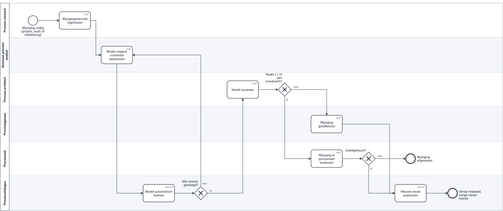
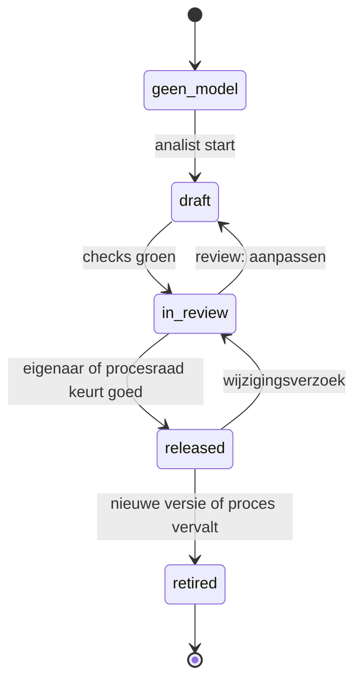

# Procesgovernance — rollen, RACI, wijzigingsflow, statussen

> **Wat:** wie wat beslist over processen bij Corvent, en hoe een wijziging loopt van verzoek tot vrijgegeven versie.
> **Voor wie:** COO, proceseigenaars, stewards, analisten, enterprise architectuur, operational excellence.
> **Status:** goedgekeurd in procesraad #1 (D-01). *Illustrative assumption — not real company data.*

← [Onboarding-kit](../05-review/onboarding-analist.md) · Volgende: [Procesraad](procesraad.md) →

## Principes

1. **Licht.** Eén wijzigingsflow, één overleg per maand, en duidelijk wie beslist. Zware governance zorgt ervoor dat mensen eromheen werken.
2. **Eigenaar beslist, steward houdt bij, architect bewaakt de standaard.** Niemand is overal R en A.
3. **De catalogus is de bron.** Een model is pas geldig als het in de catalogus *released* staat.
4. **Lean verbetert, BPM legt vast.** Operational excellence leidt verbeterprojecten; het resultaat landt als nieuwe versie in de catalogus.

## Rollen

| Rol | Wie (functie) | Verantwoordelijkheid | Tijd (indicatief) |
|---|---|---|---|
| **Procesraad** | COO (voorzitter), L1-eigenaars, process architect (secretaris), hoofd EA, OpEx-lead | beslist over L1-wijzigingen, overdrachten tussen E2E-processen, conflicten en prioriteiten | 60 min/maand |
| **L1-eigenaar** | directeur (bv. Commercial director voor OTC) | eindverantwoordelijk voor het E2E-proces en één E2E-KPI; duidt L2-eigenaars aan | 2 u/maand |
| **L2-eigenaar** | manager (bv. Customer service manager voor OTC-02) | keurt wijzigingen aan zijn proces goed, bewaakt de KPI's, beslist over regels en drempels | 1–2 u/maand |
| **Process steward** | key user of teamleider | signaleert wijzigingen, registreert verzoeken, houdt L4-instructies bij | ad hoc |
| **Business process analyst** | BPM-team | analyseert, modelleert volgens de conventie, begeleidt workshops | voltijds |
| **Process architect** | BPM-team | eigenaar van catalogus, conventie en checklist; reviewt modellen; coacht analisten; aanspreekpunt voor EA | voltijds |
| **Enterprise architect** | EA-team | eigenaar van de capability map en het applicatieregister; bewaakt de koppeling | afstemming wekelijks |
| **OpEx-lead** | operational excellence | leidt verbeterprojecten (DMAIC, kaizen); levert het verbeterde proces aan voor vastlegging | — |

## RACI

R = voert uit · A = eindverantwoordelijk (één per rij) · C = geconsulteerd · I = geïnformeerd

| Activiteit | Procesraad | L1-eig. | L2-eig. | Steward | Analist | Architect | EA | OpEx |
|---|---|---|---|---|---|---|---|---|
| Catalogus en conventie beheren | I | I | I | — | C | **A/R** | C | I |
| L2-eigenaar aanduiden | I | **A** | R | — | — | C | — | — |
| Nieuw L3-model opstellen | — | I | **A** | C | R | C | I | C |
| Model reviewen tegen de conventie | — | — | I | — | C | **A/R** | — | — |
| Wijziging binnen één L2 vrijgeven | — | I | **A** | C | R | C | I | I |
| Wijziging op L1 of aan een overdracht | **A** | R | C | — | C | R | C | C |
| Conflict tussen twee processen beslissen | **A** | C | C | — | — | R | — | — |
| Proces ↔ capability ↔ applicatie koppelen | — | — | I | — | R | **A** | C | — |
| Verbeterproject uitvoeren | I | C | **A** | C | C | I | — | R |
| Verbetering vastleggen als nieuwe versie | — | I | **A** | — | R | C | — | C |
| Verbeterportfolio prioriteren | **A** | C | C | — | — | R | — | R |

Waarom de architect bij "wijziging binnen één L2" alleen C is: de eigenaar beslist. De architect controleert de vorm, niet de inhoud.

## Wijzigingsflow

Dit is zelf een proces in de catalogus: **STE-04 Proceswijziging doorvoeren**, released v1.0, eigenaar COO. Het model haalt de checks van zijn eigen standaard.

Bestand: [`bpmn/ste-04-proceswijziging.bpmn`](bpmn/ste-04-proceswijziging.bpmn)

| Stap | Wat er gebeurt | Doorlooptijd (doel) |
|---|---|---|
| Verzoek | steward registreert: wat, waarom (project, audit, verbetering), welk proces-ID | dag 0 |
| Model aanpassen | analist werkt het model bij volgens de conventie | ≤ 5 werkdagen |
| Automatische check | `check_models.py`; bij bevindingen terug naar de analist | direct |
| Review | architect, maximaal 5 punten | ≤ 3 werkdagen |
| Beslissing | binnen één L2: de L2-eigenaar; raakt L1 of een overdracht: de procesraad | volgende raad (≤ 1 maand) |
| Publicatie | nieuwe versie *released*, vorige *retired*, reviewdatum +12 maanden | dag van beslissing |

## Statussen

| Status | Betekenis | Mag een project dit gebruiken? |
|---|---|---|
| geen model | proces staat in de catalogus, nog geen beschrijving | nee |
| draft | in opmaak | als input, niet als afspraak |
| in review | checks groen, wacht op review of beslissing | voor workshops, gemarkeerd als "voorstel" |
| released | goedgekeurd, eigenaar en reviewdatum bekend | ja, dit is de afspraak |
| retired | vervangen of vervallen | nee |

## Hoe ik dit invoer (en wat ik weglaat)

- **Start:** alleen L1-eigenaars en de procesraad. L2-eigenaars komen per domein, te beginnen bij OTC (het ERP-project).
- **Niet in v1:** SLA's op elke stap, een apart wijzigingscomité, een tool met workflow. Pas als het volume dat vraagt.
- **Meten of het werkt:** % L2 met eigenaar, % released, doorlooptijd review, aantal beslissingen per procesraad. Zie het [90-dagenplan](../01-frame/90-dagenplan.md).
